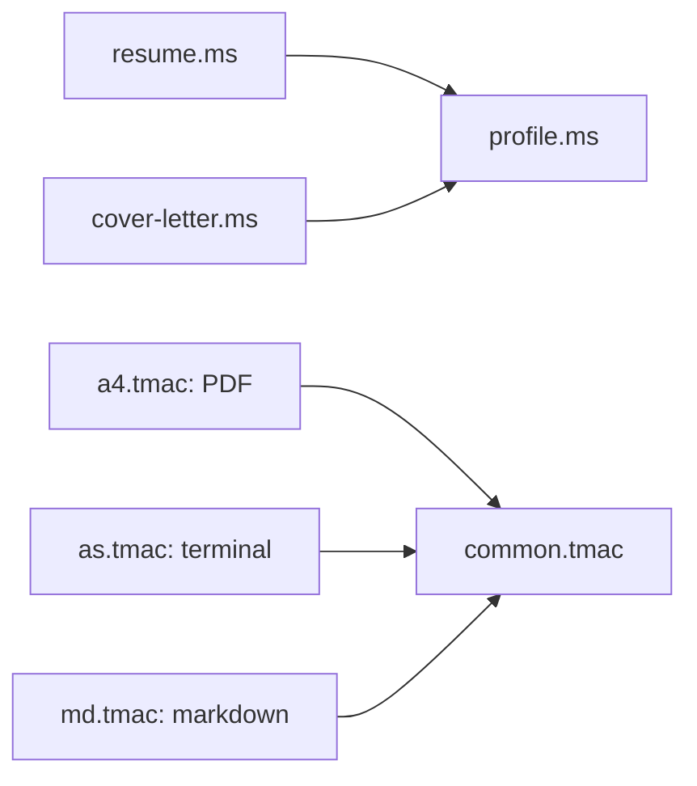

```text

           8888888b.
           888   Y88b
           888    888
           888   d88P  .d88b.  .d8888b  888  888 88888b.d88b.   .d88b.
           8888888P"  d8P  Y8b 88K      888  888 888 "888 "88b d8P  Y8b
           888 T88b   88888888 "Y8888b. 888  888 888  888  888 88888888
           888  T88b  Y8b.          X88 Y88b 888 888  888  888 Y8b. 
           888   T88b  "Y8888   88888P'  "Y88888 888  888  888  "Y8888
```

This project contains the source code for generating a my resume using [groff](https://www.gnu.org/software/groff/).

## Prerequisites

You need to have `groff` installed on your system.

### Install groff

#### macOS (using Homebrew)

```
brew install groff
```

#### Linux (Debian/Ubuntu)

```
sudo apt-get update
sudo apt-get install groff
```

#### Linux (Fedora)

```
sudo dnf install groff
```

#### Linux (Arch)

```
sudo pacman -S groff
```

## Generating the PDF

To compile the resume and generate a PDF, run:

```
make pdf
```

## Generating the terminal version

To compile the resume and generate a txt, run:

```
make txt
cat cleiton-loiola | less -R
```

## Generating the markdown version

To compile the resume to markdown (for agents and LLMs), run:

```
make md
```

`md.tmac` renders the same macros as markdown. `sed` then turns bold into `**` and groff hyphens into ASCII.

## Generating the cover letter

```
make cover
```

This writes `cleiton-loiola-cover-letter.pdf`, which is not committed.

## File layout



`profile.ms` holds the name, contact details and header that both documents share. Each document sets `TITLE`, `KEYWORDS` and `SUBJECT`, then sources it. `common.tmac` holds the macros that are the same in every output format.

You can use auto reload by typing

```
./watch
```

`make` produces `cleiton-loiola.pdf`, `cleiton-loiola` and `cleiton-loiola.md` in the current directory.

## Publishing

Bump `version` in `package.json` and push to `main`. The `publish` workflow publishes the new version to npm and redeploys [cleiton.se](https://cleiton.se). Setup is described in the site's [deployment docs](https://github.com/klaygomes/cleiton.se/blob/main/docs/deployment.md#resume-updates).

## License

See [LICENSE](LICENSE) for details.

---

Made by Cleiton at [Esta couve flor](https://www.estacouveflor.com), a blog about the whole stack, from React on the screen down to the clock tree of an STM32.
